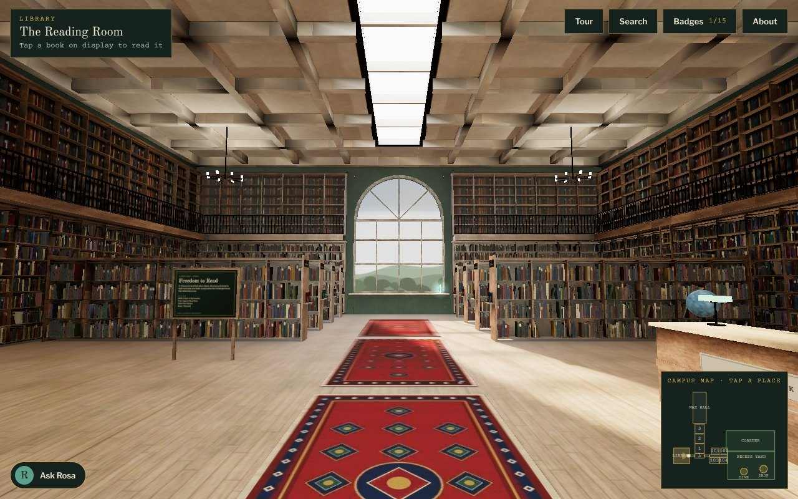

# Walk the Archive · XR Campus

A walkable 3D campus for libraries and museums: a baked, photoreal Reading Room, a wax-figure history hall,
hands-on classrooms and a recess yard. Runs in the browser on desktop and phone, and in VR headsets through WebXR.

*An unofficial concept by Ev Holt for XRLibraries. Not an official XRLibraries project.*



## Layout

| Path | What it is |
|---|---|
| `parts/` | The app: three.js r170, one file per system. `assemble.py` joins them into one page. |
| `lib/` | The baked Reading Room: `lib.glb` (Meshopt geometry, KTX2 textures, lightmaps) and `probe.hdr` (reflections). |
| `bl/` | Blender (Cycles) scripts that model, texture, bake and export the Reading Room. |
| `tools/` | glTF compression, the asset manifest, the minifier. |
| `hk/` | Avatar build: converts Microsoft Rocketbox avatars (MIT, see `hk/ROCKETBOX-LICENSE.txt`). |
| `test/` | Headless Playwright checks and screenshot scripts; `test/shots*/` holds their screenshots. |
| `assets/` | Bake work files: the Blender scenes (`assets/lib/*.blend`, open in Blender 5.2), raw HDR lightmaps, the uncompressed glTF export, and the generated textures (`assets/tex/`). |
| `hk/out/` | Built avatars: `h/` for the site, `art/h/` base64 copies for the Claude artifact. |
| `deploy/` · `xrlibraries-campus.html` | Built pages: the standalone site and the Claude artifact build. |
| `make_patch.mjs` · `build_deploy.py` | Vercel preview deploys. |
| `docs/` | Notes (realism plan, bake procedure) and `docs/screenshots/`. |

Everything in the Reading Room was modelled, textured and lit from scratch in Blender with procedurally
generated textures; nothing was downloaded from asset libraries.

## Run it locally

From the repo root, with Python 3 (the page and avatars are already built):

```sh
cp -r hk/out/h deploy/h                              # avatars
cp -r lib deploy/lib                                 # baked rooms
python3 -m http.server 8000 --directory deploy       # open http://localhost:8000
```

After editing `parts/`, run `python3 assemble.py` to rebuild `deploy/index.html`.
To rebuild the avatars from the Rocketbox originals (Node 22+):
`npm install --prefix hk && node hk/build.mjs deploy/h --expect hk/names.json`.

## Rebake the Reading Room

The baked scene is already in `assets/lib/bake_work.blend`; open it in Blender 5.2 to look around or edit.
To rebake from scratch you need Python 3.13 and KTX-Software 4.4+ (`ktx` on PATH):

```sh
python3.13 -m venv bl && bl/bin/pip install bpy==5.2.2
bl/bin/python bl/textures.py
bl/bin/python bl/library.py --nobake                 # scene + lightmap UVs -> assets/lib/library.blend
bl/bin/python bl/bake.py --lm 128 --vc 96 --size 2048   # resumable, ~45 min on 2 CPU cores
bl/bin/python bl/bake_rows.py
bl/bin/python bl/post.py
npm install --prefix tools && node tools/post.mjs assets/lib lib
```
