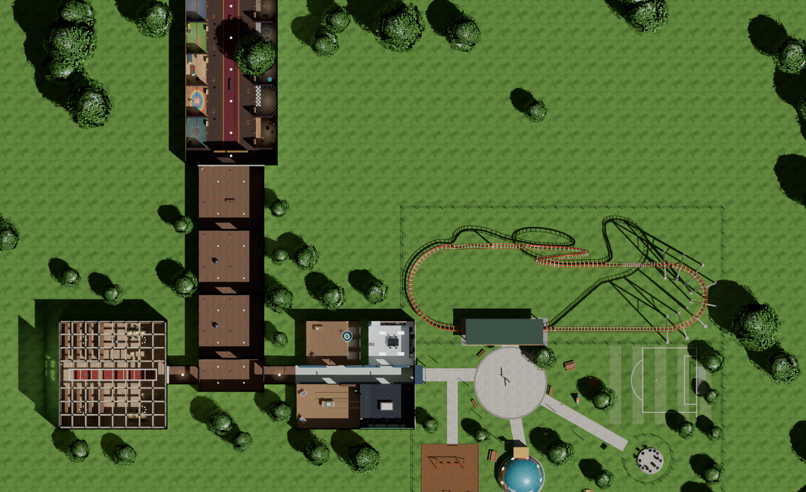

# Walk the Archive · Unreal Engine 5.8

The XRLibraries Campus, rebuilt as a PC game in **Unreal Engine 5.8**: the same museum, Wax Hall, Reading Room,
Workshop School and Recess Yard as the web version, lit in real time with Lumen and ray tracing, built from Nanite
geometry, and ready for MetaHuman people.

*An unofficial concept by Ev Holt for XRLibraries. Not an official XRLibraries project.*

## Start here

| You want to… | Open |
|---|---|
| Have Claude set it up on your computer | [`COWORK_PROMPT.md`](COWORK_PROMPT.md) (paste-ready prompts) |
| Follow or check the setup steps | [`COWORK.md`](COWORK.md) (the runbook) |
| Know why Unreal, what changed, what's next | [`docs/DECISIONS.md`](docs/DECISIONS.md) · [`docs/ROADMAP.md`](docs/ROADMAP.md) |
| Make it photoreal | [`docs/LOOKDEV.md`](docs/LOOKDEV.md) |
| Add real people (MetaHumans) | [`docs/HUMANS.md`](docs/HUMANS.md) |
| Put it in front of people | [`docs/DELIVERY.md`](docs/DELIVERY.md) |

## What's in this folder

| Path | What it is |
|---|---|
| `WalkTheArchive/` | The Unreal project: `WalkTheArchive.uproject`, `Config/` (rendering: Lumen, ray tracing, Nanite, Virtual Shadow Maps, MegaLights, TSR, Substrate), `Source/` (C++ game code), `Content/Python/wta_setup/` + `Scripts/setup_project.py` (builds the level inside Unreal), `Data/` (17 DataTables as JSON) |
| `Pipeline/` | How the web campus became Unreal input: the exporters and their outputs (`out/ue/*.glb`, art, lights), extracted content, layout spec. See [`Pipeline/README.md`](Pipeline/README.md) |
| `Tools/` | One-command scripts for Windows (`win/*.ps1`) and Mac (`mac/*.sh`): preflight, install, build, setup, play, package |
| `contract/` | The rules every file follows (names, paths, data shapes) and the C++ API list |
| `docs/` | Decisions, roadmap, MetaHumans, delivery, look-dev; `docs/reference/` holds the research and specs with sources |
| `cowork/` | A Cowork skill (`walk-the-archive-unreal.zip`) to upload once |
| `Tests/` | Checks that run without Unreal (the setup scripts against a stand-in `unreal` module) |

Nothing in here is a binary Unreal asset. The `.uasset`/`.umap` content is generated on your machine by the setup
script, so the repo stays small and every step is reproducible.

## Status

| Milestone | State |
|---|---|
| Campus exported from the web build (geometry, art, lights, content, layout) | Done, validated |
| Unreal project, C++ game code, editor setup, tools, runbook | Written here; first build and run happen on your computer (`COWORK.md` Steps 3–5) |
| Photoreal look-dev, MetaHumans, Wax Hall scenes, stations, rides, VR, shipping | Next, see [`docs/ROADMAP.md`](docs/ROADMAP.md) |

## What your computer needs

Windows 11 with an NVIDIA RTX or AMD RX 6000-series (or newer) GPU with 8 GB+ VRAM for the full look (12–16 GB is
comfortable), 32 GB RAM, and about 250 GB free on an SSD. Apple-silicon Macs (M2 or newer) work with software Lumen.
Intel Macs can't run Unreal 5.8's renderer.
